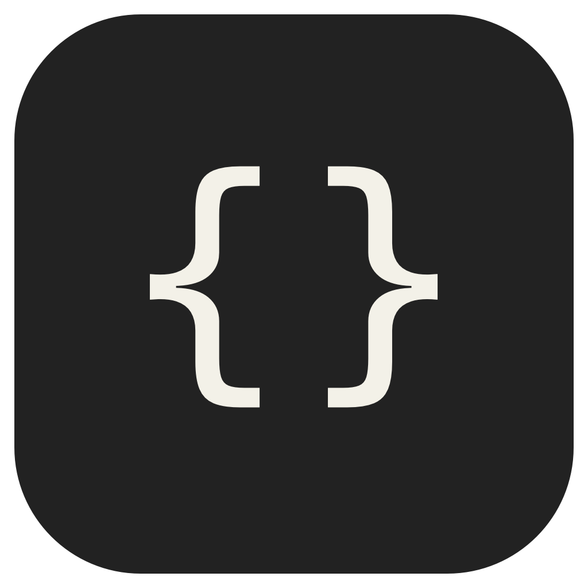
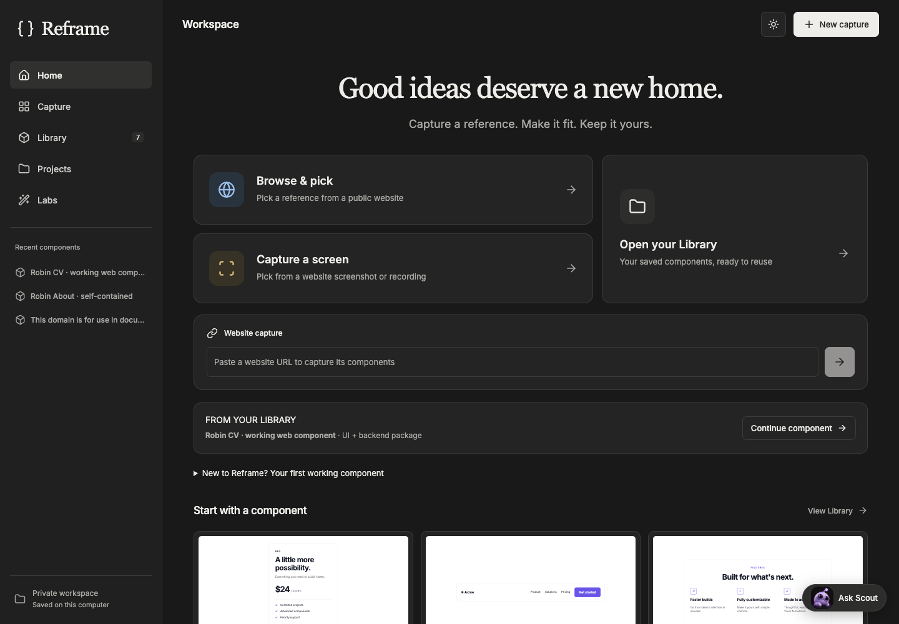
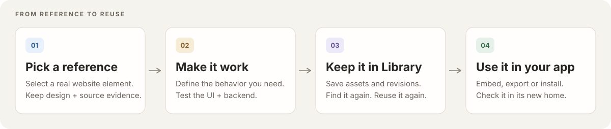
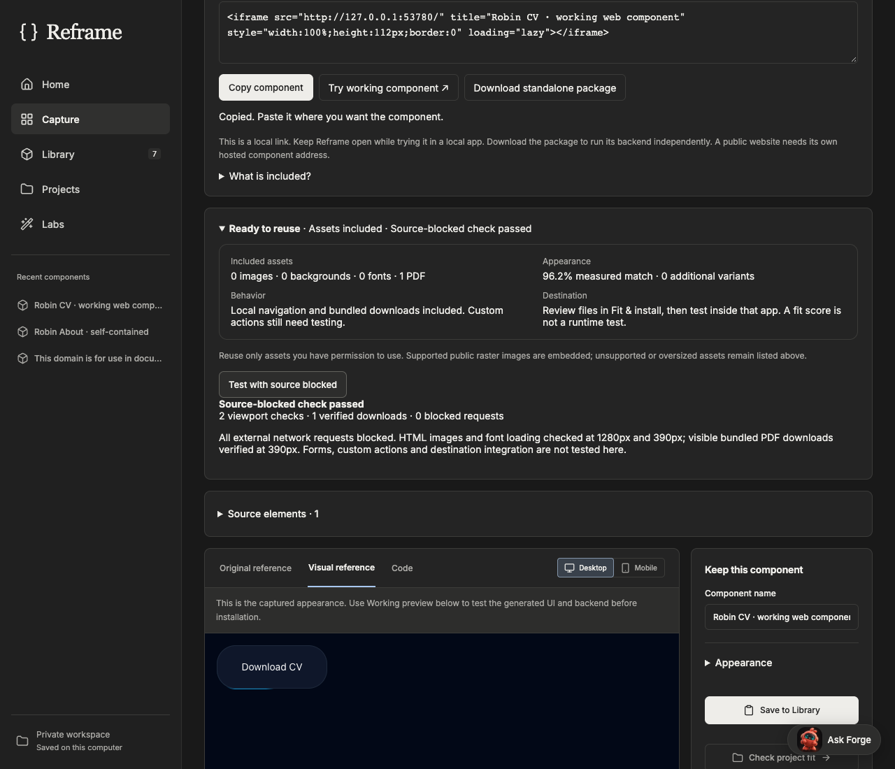
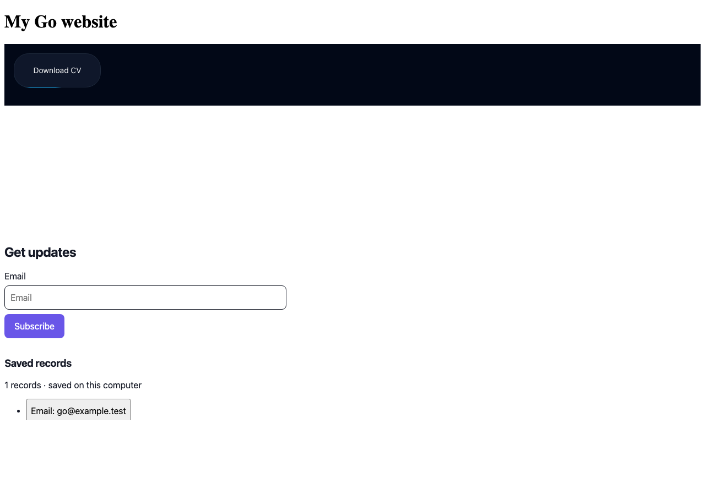
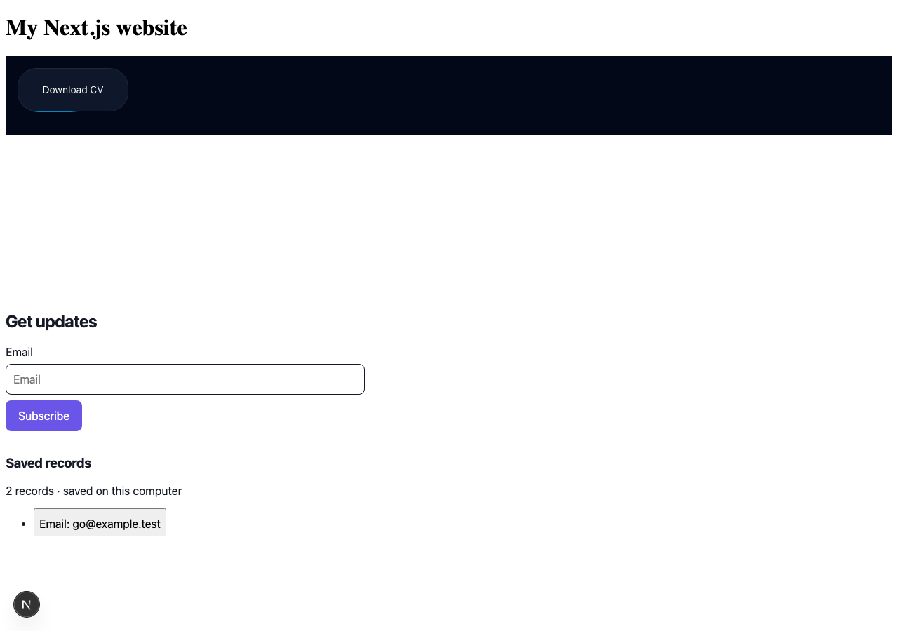
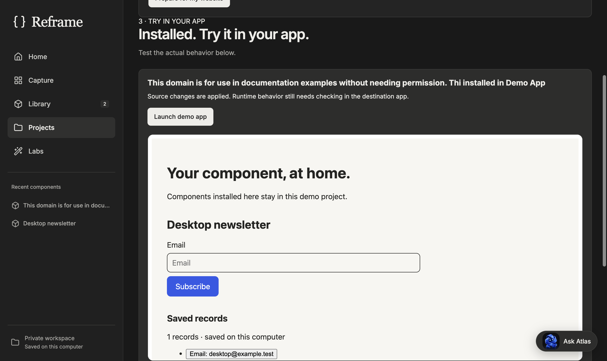
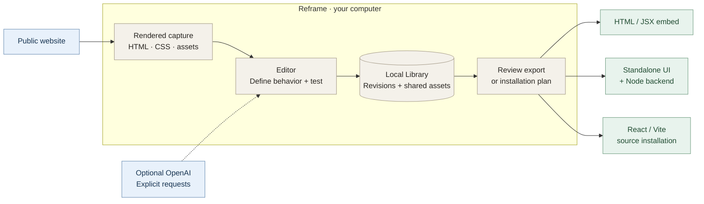

<div align="center">
  
  <h1>Reframe</h1>
  <p><strong>Point. Pick. Make it work.</strong></p>
  <p>Turn a component you like on the web into a reusable, working part of your own app.</p>
  <p>
    <a href="#quick-start">Get started</a> ·
    <a href="#see-the-workflow">Product tour</a> ·
    <a href="#where-your-components-can-run">Compatibility</a> ·
    <a href="#macos-desktop">macOS</a> ·
    <a href="docs/README.md">Docs</a>
  </p>
  <p>
    <a href="https://github.com/robinfrancis186/reframe/actions/workflows/verify.yml"></a>
    
    
  </p>
</div>



<p align="center"><sub>Actual Reframe interface. Start with a reference; keep the result in your own workspace.</sub></p>

## Good ideas deserve a new home

You find a useful card, a well-designed form, or a button that would fit your project. Reframe helps you capture its rendered design, define what it should do, and test it before bringing it into your app.

**Start without an API key or a destination project.** The included demo app lets you try installation first.



Reframe reads what the browser can observe. It does **not** recover a website's original framework source, private backend or every hidden interaction. Unknown business logic needs a behavior definition.

## See the workflow

### Capture the design. Check what travels with it.

The editor brings the reference, code, behavior and **Ready to reuse** report together. The report identifies bundled assets and remaining dependencies; a measured visual match is separate from a working behavior test.



### Take it into another app

These are actual local verification screenshots. The captured **Download CV** component from RobinFrancis.in was embedded in separate Go and Next.js apps. Both downloaded its bundled **80,412-byte PDF** with external requests blocked. The newsletter alongside it is a separately authored fixture; its records survived reload.

<table>
  <tr>
    <th>Inside a Go website</th>
    <th>Inside a Next.js app</th>
  </tr>
  <tr>
    <td><a href="docs/evidence/web-reuse-2026-10-25/go-embed.png"></a></td>
    <td><a href="docs/evidence/web-reuse-2026-10-25/nextjs-embed.png"></a></td>
  </tr>
</table>

Cross-framework reuse here uses an **iframe with its own Node backend**, rather than rewriting Go or Next.js server code. [Read the results and boundaries →](docs/evidence/web-reuse-2026-10-25/README.md)

<details>
<summary><strong>See a working component installed in the Mac app's demo</strong></summary>



The installation flow includes a file review, permission to apply changes, a demo launcher and a real destination preview. [macOS verification evidence →](docs/evidence/macos-2026-10-25/README.md)

</details>

## What you can do

| Capability | How it helps |
| --- | --- |
| **Browse & pick** | Render JavaScript websites in the built-in browser, or use the explicitly paired Chrome extension. |
| **Reusable Library** | Search, tag, collect and reopen components. Image thumbnails keep browsing separate from full working previews. |
| **Behavior builder** | Build supported navigation, validation, record storage and declared actions. Configure account and external-service requirements explicitly. |
| **Working previews** | Test the generated UI and backend with disposable data before installing. |
| **Ready to reuse** | Inspect supported images, fonts, backgrounds and PDFs; test supported assets with the source blocked. |
| **Export & install** | Choose Faithful or supported Clean & responsive output; review destination files and use guarded installation undo. |
| **Optional assistance** | Explicit OpenAI actions, plus agents, MCP connections, Gradio and testing tools in **Labs**. |

## Quick start

Requires **Node.js 24.11.1 or newer** and **npm**.

```sh
git clone https://github.com/robinfrancis186/reframe.git
cd reframe
npm ci
npx playwright install chromium
npm run dev
```

Open **[localhost:5173](http://localhost:5173)**.

1. Choose **Browse & pick**, enter a public website URL and select a small component.
2. Choose **Open in editor**. Review included behavior or choose **Define behavior**, then **Build working component**.
3. Start a working preview and test the actual controls. Save to **Library**.
4. Choose **Fit & install → Use demo app → Review installation**. Approve the files, install, then **Launch demo app**.

For an embed instead, choose **Prepare for my website → Copy component**. [Follow the first-component guide →](docs/WEB_WORKFLOW.md)

<details>
<summary><strong>Linux setup and optional OpenAI assistance</strong></summary>

On Linux, replace the Chromium installation step with:

```sh
npx playwright install --with-deps chromium
```

Ordinary website capture, Library operations and deterministic generation need **no OpenAI key**. To enable AI assistance, copy [`.env.example`](.env.example) to `.env`, add your `OPENAI_API_KEY`, then restart. Supported requests also accept a user-supplied key in the app.

AI actions are explicit; ordinary editing does not silently start paid requests. Keys are not included in component exports. Local OCR and macOS packaging require macOS and their documented toolchains.

</details>

## Where your components can run

| Destination | Reuse method | What to expect |
| --- | --- | --- |
| **React / Vite** | Reviewed source installation, or an embed. | Direct working source installation is supported for this route. |
| **React / Next.js** | Copy the JSX iframe snippet. | The component retains its independently running Node backend. |
| **HTML / Go / other web frameworks** | Paste the HTML iframe into a page or template that accepts it. | Reuses the rendered component; does not generate native server handlers. |
| **Standalone** | Download the UI/backend ZIP and run `node start.mjs`. | Requires Node 24; the exported package needs no `npm install`. |

The **source** website can use React, Next.js, Go or another framework: capture reads its rendered browser output. Access restrictions, missing resources and unsupported controls can still limit capture.

> Copied URLs are local. Keep Reframe open while trying them. For a public website, host the standalone component separately with HTTPS and appropriate production services. Do not expose Reframe's local project-editing API.

## How it works



| Layer | Technology |
| --- | --- |
| Interface | React 19 · TypeScript · Vite · custom CSS · Lucide icons |
| Local backend | Node.js · Express 5 |
| Browser engine | Playwright · Chromium |
| Mac application | Electron · Electron Forge |
| Persistence | File-based Library and shared assets · IndexedDB for pending offline edits |

Explore the [architecture map](docs/architecture/graphify/README.md) for implementation details.

## macOS desktop

Reframe has an **Apple Silicon** desktop build with bundled Node, Chromium and a macOS Vision OCR helper. Normal capture in the packaged app needs no separately installed Node or Chrome.

To build it locally on an Apple Silicon Mac with the Xcode command-line tools:

```sh
npm run desktop:package
```

```text
out/
├── Reframe-darwin-arm64/Reframe.app
└── make/Reframe-arm64-local-unsigned.dmg
```

The current local build is **not Developer ID signed or notarized**; this repository does not offer a verified signed download. Direct-from-DMG capture-to-install, restart and recovery have dated local evidence. Installation on another Mac remains a separate release gate. [Desktop setup →](docs/RELEASE.md)

## Verified behavior, clear boundaries

The retained **25 October 2026** web verification records **177 passing tests**, formatting, linting, client/server types and all three web builds. These are dated local results. Later focused regressions and package checks are tracked separately.

- [Web capture, source-blocked assets and Go / Next.js results](docs/evidence/web-reuse-2026-10-25/README.md)
- [Packaged Mac app, installation and recovery checks](docs/evidence/macos-2026-10-25/README.md)
- [Verification history and remaining gates](docs/VERIFICATION.md)

**A visual score is not a behavior test.** A locally saved form record is not delivered email, and a cart is not a payment service. Public multiuser hosting, arbitrary private backend recovery and verified Android/iOS runtimes are outside the current web-focused release.

<details>
<summary><strong>Local data, privacy and ownership</strong></summary>

The development Library lives in `.reframe/library/`, with individual revisions, shared assets and ten retained manifests. Pending offline operations stay in IndexedDB. The Mac app uses its separate user-data folder and supports explicit Library import.

`.env`, local Libraries, credentials, dependencies and build artifacts stay out of Git. Chrome extension pairing is explicit and does not transfer signed-in sessions into the isolated browser. Reuse only assets you have permission to use; fonts, logos and artwork retain their owners' rights.

</details>

## Contribute and explore

```sh
npm run verify      # Formatting, lint, types, three web builds and tests
npm run benchmark   # Library benchmarks at 150 / 500 / 1,000 components
```

| Start here | Go deeper |
| --- | --- |
| [First working component](docs/WEB_WORKFLOW.md) | [Contributing and development](CONTRIBUTING.md) |
| [All documentation](docs/README.md) | [MCP assistant connections](docs/CONNECTIONS.md) |
| [macOS setup and release gates](docs/RELEASE.md) | [Third-party notices](THIRD_PARTY_NOTICES.md) |

Ponytail supplies generation guidance, REA supplies static source analysis, and Graphify supplies optional code maps. The inaccessible Turnitout engine is not bundled; **Reframe Copy Polish** is an independently authored replacement. See [the notices](THIRD_PARTY_NOTICES.md) for attribution and scope.

<div align="center">
  <br />
  <strong>Capture a reference. Make it fit. Keep it yours.</strong><br />
  Built by <a href="https://github.com/robinfrancis186">Robin Francis</a>.
</div>
