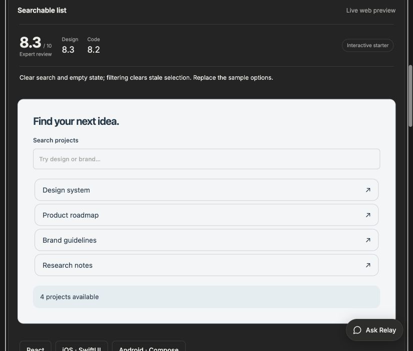
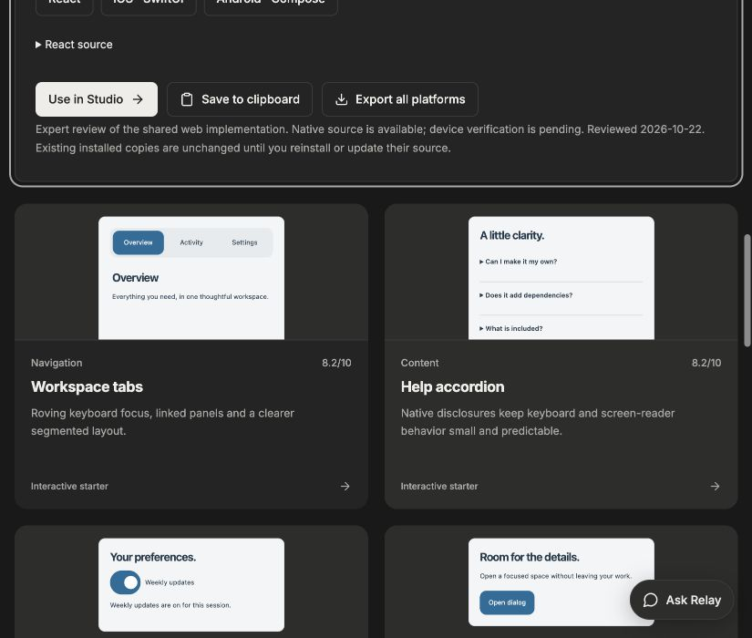

# Reframe Originals library review — 22 October 2026

Reviewed all 114 catalog presets through their 46 shared web implementations. This is an expert code/design assessment, not a user study or production certification. Scores for variants sharing an implementation are intentionally equal.

**Overall: 5.8 → 7.1/10. Design: 5.3 → 7.0; code: 6.2 → 7.3.** Each preset has equal weight; scores average design and code, rounded to one decimal.

## Rubric

- Design: hierarchy, spacing, brand adaptation, states, keyboard/focus visibility, small-screen fit, and whether the design delivers its named pattern.
- Code: correct local behavior, semantics, errors, bounded state, standalone export, dependency cost and integration safety.
- 8–9: strong starter with clear limits; 7–7.9: useful starter requiring product work; 6–6.9: partial pattern; below 6: substantial redesign or missing named behavior. No score certifies an external service or native runtime.

## Implemented improvements

- Shared visual system: more deliberate spacing and type hierarchy, 44px actions, focus treatment, readable status/empty states, modal surfaces, segmented tabs, results rows, responsive sizing and reduced-motion support. Native controls inherit the project light/dark scheme.
- Library browsing: real inert component thumbnails, per-preset design/code ratings, useful limitations in cards, corrected categories, brand-preserving clipboard saves, and on-demand React/native source inspection.
- Fixed stale search selection, dialog padding dismissal, lost archive history/order, stale signup success, stale files after rejection, missing table empty state, misleading diff copying and hidden clipboard errors. Bounded message/notification histories. Explicit button types prevent accidental destination-form submission.
- Export styles now include common styles plus the selected family. Total uncompressed source for one of every preset: 956,856 → 708,500 bytes (26.0% smaller). Same theme, component name and TypeScript setting; file sizes are not runtime performance measurements. Family CSS: 3695–4448 characters, previously 6,346. Shared variant branches still exist in AI/chart exports.

## Verification and boundaries

- Real exported React destination fixture at 390px: search/clear, parent-form safety, no page overflow, dialog interior/Escape/focus return, two-item archive undo/order, signup edit reset, invalid file replacement, table empty state, clipboard rejection and tab keyboard navigation.
- All catalog ratings and selected-style groups checked. Existing suite checks JSX/TSX generation and strict TypeScript, branded packages, destination insertion and safe undo. See VERIFICATION.md for the final run.
- Manually inspected workbench screenshots before and after; not every named variant has received a separate visual/assistive-technology test.
- Existing installed copies remain unchanged. New exports and installations use the improvements. Android/iOS source remains available; these visual/behavior changes target React and native device testing is pending.

## Remaining priorities

1. Replace simplified financial charts and galleries with distinct geometry/layouts appropriate to each name, with real-data tests.
2. Replace sample datasets, navigation targets and counter actions with project-specific contracts.
3. Connect AI, authentication, uploads and financial services explicitly; the library must continue showing these as service demos until verified.
4. Validate screen readers, mobile touch gestures and native runtime in destination apps.

## Visual evidence

## Every preset

| Preset | Before | Design now | Code now | Overall now | Readiness and remaining work |
|---|---:|---:|---:|---:|---|
| Workspace tabs (tabs) | 7.3 | 8.2 | 8.2 | 8.2 | **Interactive starter**. Roving keyboard focus, linked panels and a clearer segmented layout. |
| Help accordion (accordion) | 7.5 | 8.0 | 8.3 | 8.2 | **Interactive starter**. Native disclosures keep keyboard and screen-reader behavior small and predictable. |
| Preference switch (switch) | 7.3 | 8.0 | 8.3 | 8.2 | **Interactive starter**. A 44px target, visible state and labelled switch; preferences remain session-local. |
| Quick dialog (dialog) | 6.0 | 8.0 | 8.0 | 8.0 | **Interactive starter**. Native focus handling; clicking inside dialog padding no longer dismisses it. |
| Status notice (toast) | 6.5 | 7.8 | 8.0 | 7.9 | **Interactive starter**. Announced confirmation with an explicit dismiss action. |
| Range control (slider) | 7.3 | 8.0 | 8.2 | 8.1 | **Interactive starter**. Native keyboard input and a visible numeric value. |
| Searchable list (search) | 5.8 | 8.3 | 8.2 | 8.3 | **Interactive starter**. Clear search and empty state; filtering clears stale selection. Replace the sample options. |
| Quantity stepper (quantity) | 7.0 | 8.0 | 8.2 | 8.1 | **Interactive starter**. Bounded seat count and labelled actions; billing is a separate integration. |
| Onboarding steps (steps) | 6.5 | 7.8 | 7.8 | 7.8 | **Interactive starter**. Ordered progress with forward/back controls; replace sample onboarding content. |
| Action menu (menu) | 7.0 | 7.8 | 8.0 | 7.9 | **Interactive starter**. Native disclosure closes and returns focus after choosing an action. |
| Copy field (copy) | 7.0 | 7.8 | 8.0 | 7.9 | **Interactive starter**. Clipboard permission errors remain visible, with manual-copy guidance. |
| Brand card (brand) | 6.5 | 8.0 | 8.0 | 8.0 | **Interactive starter**. Brand tokens, supplied logo and expandable copy; replace the introduction. |
| Voice Orb (be-voice-orb) | 5.3 | 6.8 | 6.8 | 6.8 | **Service demo**. Local supplied-content states; bounded draft history and explicit copy errors. Shared implementation still carries variant branches. |
| Message Bubble (be-message-bubble) | 5.3 | 6.8 | 6.8 | 6.8 | **Service demo**. Local supplied-content states; bounded draft history and explicit copy errors. Shared implementation still carries variant branches. |
| Message (be-message) | 5.3 | 6.8 | 6.8 | 6.8 | **Service demo**. Local supplied-content states; bounded draft history and explicit copy errors. Shared implementation still carries variant branches. |
| Message Scroller (be-message-scroller) | 5.3 | 6.8 | 6.8 | 6.8 | **Service demo**. Local supplied-content states; bounded draft history and explicit copy errors. Shared implementation still carries variant branches. |
| Prompt Input (be-prompt-input) | 5.3 | 6.8 | 6.8 | 6.8 | **Service demo**. Local supplied-content states; bounded draft history and explicit copy errors. Shared implementation still carries variant branches. |
| Todo List (be-todo-list) | 5.3 | 6.8 | 6.8 | 6.8 | **Service demo**. Local supplied-content states; bounded draft history and explicit copy errors. Shared implementation still carries variant branches. |
| Code Block (be-code-block) | 5.3 | 6.8 | 6.8 | 6.8 | **Service demo**. Local supplied-content states; bounded draft history and explicit copy errors. Shared implementation still carries variant branches. |
| Approval Card (be-approval-card) | 5.3 | 6.8 | 6.8 | 6.8 | **Service demo**. Local supplied-content states; bounded draft history and explicit copy errors. Shared implementation still carries variant branches. |
| File Diff (be-file-diff) | 5.3 | 6.8 | 6.8 | 6.8 | **Service demo**. Local supplied-content states; bounded draft history and explicit copy errors. Shared implementation still carries variant branches. |
| Tool Result (be-tool-result) | 5.3 | 6.8 | 6.8 | 6.8 | **Service demo**. Local supplied-content states; bounded draft history and explicit copy errors. Shared implementation still carries variant branches. |
| Streaming Response (be-streaming-response) | 5.3 | 6.8 | 6.8 | 6.8 | **Service demo**. Local supplied-content states; bounded draft history and explicit copy errors. Shared implementation still carries variant branches. |
| Image Generation (be-image-generation) | 5.3 | 6.8 | 6.8 | 6.8 | **Service demo**. Local supplied-content states; bounded draft history and explicit copy errors. Shared implementation still carries variant branches. |
| Tool Approval (be-tool-approval) | 5.3 | 6.8 | 6.8 | 6.8 | **Service demo**. Local supplied-content states; bounded draft history and explicit copy errors. Shared implementation still carries variant branches. |
| Citations (be-citations) | 5.3 | 6.8 | 6.8 | 6.8 | **Service demo**. Local supplied-content states; bounded draft history and explicit copy errors. Shared implementation still carries variant branches. |
| Agent Activity (be-agent-activity) | 5.3 | 6.8 | 6.8 | 6.8 | **Service demo**. Local supplied-content states; bounded draft history and explicit copy errors. Shared implementation still carries variant branches. |
| Agent Loading States (be-loading-states) | 5.3 | 6.8 | 6.8 | 6.8 | **Service demo**. Local supplied-content states; bounded draft history and explicit copy errors. Shared implementation still carries variant branches. |
| AI Sidebar (be-ai-sidebar) | 5.3 | 6.8 | 6.8 | 6.8 | **Service demo**. Local supplied-content states; bounded draft history and explicit copy errors. Shared implementation still carries variant branches. |
| Chat App (be-chat-app) | 5.3 | 6.8 | 6.8 | 6.8 | **Service demo**. Local supplied-content states; bounded draft history and explicit copy errors. Shared implementation still carries variant branches. |
| Timeline (be-timeline) | 6.0 | 7.0 | 7.2 | 7.1 | **Interactive starter**. Local step navigation; this is not a dated activity history. |
| Animated Alert (be-alert) | 6.5 | 7.8 | 7.8 | 7.8 | **Interactive starter**. Semantic alert and explicit dismissal; use assertive announcements sparingly. |
| Animated Collapsible (be-collapsible) | 7.5 | 8.0 | 8.3 | 8.2 | **Interactive starter**. Native disclosures keep keyboard and screen-reader behavior small and predictable. |
| Aspect Ratio (be-aspect-ratio) | 4.8 | 5.5 | 6.5 | 6.0 | **Adaptation starter**. Abstract sample panels; real assets, masonry pagination and cylindrical layout are not implemented. |
| Arc Picker (be-arc-picker) | 5.8 | 6.5 | 7.0 | 6.8 | **Adaptation starter**. Labelled options and native selection; wheel physics are not implemented. |
| Sortable List (be-sortable-stack) | 5.8 | 7.7 | 8.0 | 7.8 | **Interactive starter**. Keyboard reorder controls plus drag; archive undo now restores every item at its prior position. |
| Image Viewer (be-image-viewer) | 4.8 | 5.5 | 6.5 | 6.0 | **Adaptation starter**. Abstract sample panels; real assets, masonry pagination and cylindrical layout are not implemented. |
| Date Range Picker (be-date-range-picker) | 6.5 | 7.8 | 8.0 | 7.9 | **Interactive starter**. Range validation and clear action; scheduling availability and time zones need your service. |
| Card (be-card) | 6.3 | 7.5 | 7.8 | 7.7 | **Interactive starter**. Brand-aware surface and selection state; tilt respects reduced motion. |
| Color Picker (be-color-picker) | 6.5 | 7.5 | 7.8 | 7.7 | **Interactive starter**. Native color input with labelled presets and visible hex output. |
| Animated Color Selector (be-color-selector) | 6.5 | 7.5 | 7.8 | 7.7 | **Interactive starter**. Native color input with labelled presets and visible hex output. |
| Animated Breadcrumb (be-breadcrumb) | 6.5 | 7.5 | 7.8 | 7.7 | **Interactive starter**. Semantic navigation and local path state; connect the application router. |
| Tilt Card (be-tilt-card) | 6.3 | 7.5 | 7.8 | 7.7 | **Interactive starter**. Brand-aware surface and selection state; tilt respects reduced motion. |
| Button (be-button) | 5.5 | 6.8 | 7.0 | 6.9 | **Adaptation starter**. Explicit non-submit actions and disclosure state; replace the interaction counter with product actions. |
| Animated CTA Buttons (be-expanding-arrow-button) | 5.5 | 6.8 | 7.0 | 6.9 | **Adaptation starter**. Explicit non-submit actions and disclosure state; replace the interaction counter with product actions. |
| Expandable Control (be-expandable-control) | 5.5 | 6.8 | 7.0 | 6.9 | **Adaptation starter**. Explicit non-submit actions and disclosure state; replace the interaction counter with product actions. |
| Marquee (be-marquee) | 5.3 | 5.8 | 6.8 | 6.3 | **Adaptation starter**. Pause/replay and reduced motion; variants share an ambient animation, not shaders or a real marquee. |
| Input (be-input) | 6.8 | 7.8 | 8.0 | 7.9 | **Interactive starter**. Native email validation, labelled input and explicit form submission. |
| Select (be-select) | 6.0 | 7.0 | 7.0 | 7.0 | **Adaptation starter**. Native select with a filter; not a full ARIA autocomplete combobox. |
| Combobox (be-combobox) | 6.0 | 7.0 | 7.0 | 7.0 | **Adaptation starter**. Native select with a filter; not a full ARIA autocomplete combobox. |
| Multi Select (be-multi-select) | 6.5 | 7.8 | 7.8 | 7.8 | **Interactive starter**. Grouped, labelled native choices and selection feedback. |
| Checkbox (be-checkbox) | 6.5 | 7.8 | 7.8 | 7.8 | **Interactive starter**. Grouped, labelled native choices and selection feedback. |
| Radio Group (be-radio) | 6.5 | 7.8 | 7.8 | 7.8 | **Interactive starter**. Grouped, labelled native choices and selection feedback. |
| Bottom Sheet (be-bottom-sheet) | 5.5 | 7.4 | 7.8 | 7.6 | **Adaptation starter**. Native modal, focus and corrected backdrop dismissal; popover/context-menu variants remain modal adaptations. |
| Pull to Refresh (be-pull-to-refresh) | 5.8 | 6.5 | 7.0 | 6.8 | **Adaptation starter**. Cancellable local refresh timer; touch pull gestures and a data loader still need integration. |
| Shared Layout Background (be-shared-layout-bg) | 6.0 | 7.0 | 7.2 | 7.1 | **Adaptation starter**. Current-page semantics and compact navigation; route bindings and advanced transitions remain application work. |
| Bounce Sidebar (be-bounce-sidebar) | 6.0 | 7.0 | 7.2 | 7.1 | **Adaptation starter**. Current-page semantics and compact navigation; route bindings and advanced transitions remain application work. |
| Animated Sidebar (be-animated-sidebar) | 6.0 | 7.0 | 7.2 | 7.1 | **Adaptation starter**. Current-page semantics and compact navigation; route bindings and advanced transitions remain application work. |
| File Tree (be-file-tree) | 5.8 | 6.8 | 7.0 | 6.9 | **Adaptation starter**. Disclosure and selection work; sample file names are not a filesystem connection. |
| Preview Rail (be-preview-rail) | 6.0 | 7.0 | 7.2 | 7.1 | **Adaptation starter**. Current-page semantics and compact navigation; route bindings and advanced transitions remain application work. |
| Dock (be-dock) | 6.0 | 7.0 | 7.2 | 7.1 | **Adaptation starter**. Current-page semantics and compact navigation; route bindings and advanced transitions remain application work. |
| Tooltip (be-tooltip) | 6.5 | 7.4 | 7.8 | 7.6 | **Interactive starter**. Focus, pointer and Escape support; test assistive technology in the destination. |
| Animated Context Menu (be-context-menu) | 5.5 | 7.4 | 7.8 | 7.6 | **Adaptation starter**. Native modal, focus and corrected backdrop dismissal; popover/context-menu variants remain modal adaptations. |
| Popover (be-popover) | 5.5 | 7.4 | 7.8 | 7.6 | **Adaptation starter**. Native modal, focus and corrected backdrop dismissal; popover/context-menu variants remain modal adaptations. |
| Morphing Modal (be-morphing-modal) | 5.5 | 7.4 | 7.8 | 7.6 | **Adaptation starter**. Native modal, focus and corrected backdrop dismissal; popover/context-menu variants remain modal adaptations. |
| Center Morph Modal (be-center-morph-modal) | 5.5 | 7.4 | 7.8 | 7.6 | **Adaptation starter**. Native modal, focus and corrected backdrop dismissal; popover/context-menu variants remain modal adaptations. |
| Text Animation (be-text-animation) | 5.3 | 5.8 | 6.8 | 6.3 | **Adaptation starter**. Pause/replay and reduced motion; variants share an ambient animation, not shaders or a real marquee. |
| Number Animation (be-number) | 6.5 | 7.5 | 7.8 | 7.7 | **Interactive starter**. Visible numeric state and live announcement; animation is a reveal, not digit interpolation. |
| Animated Badge (be-animated-badge) | 5.8 | 7.0 | 7.5 | 7.3 | **Interactive starter**. Announced state and dismissible notices; retained stack is bounded to ten notices. |
| Action Swap (be-action-swap) | 5.5 | 6.8 | 7.0 | 6.9 | **Adaptation starter**. Explicit non-submit actions and disclosure state; replace the interaction counter with product actions. |
| Animated Toast Stack (be-animated-toast-stack) | 5.8 | 7.0 | 7.5 | 7.3 | **Interactive starter**. Announced state and dismissible notices; retained stack is bounded to ten notices. |
| Theme Toggle (be-theme-toggle) | 6.0 | 7.0 | 7.2 | 7.1 | **Interactive starter**. Local appearance preview; host project theme persistence is separate. |
| Drawer (be-drawer) | 5.5 | 7.4 | 7.8 | 7.6 | **Adaptation starter**. Native modal, focus and corrected backdrop dismissal; popover/context-menu variants remain modal adaptations. |
| Scroll Animation (be-scroll-animation) | 5.3 | 5.8 | 6.8 | 6.3 | **Adaptation starter**. Pause/replay and reduced motion; variants share an ambient animation, not shaders or a real marquee. |
| Wheel Picker (be-wheel-picker) | 5.8 | 6.5 | 7.0 | 6.8 | **Adaptation starter**. Labelled options and native selection; wheel physics are not implemented. |
| Table (be-table) | 6.3 | 8.0 | 8.2 | 8.1 | **Interactive starter**. Sortable progress, labelled row selection and a visible empty-filter state. |
| Shader Background (be-shader-background) | 5.3 | 5.8 | 6.8 | 6.3 | **Adaptation starter**. Pause/replay and reduced motion; variants share an ambient animation, not shaders or a real marquee. |
| Cylinder Carousel (be-cylinder-carousel) | 4.8 | 5.5 | 6.5 | 6.0 | **Adaptation starter**. Abstract sample panels; real assets, masonry pagination and cylindrical layout are not implemented. |
| Loader (be-loader) | 5.8 | 7.0 | 7.5 | 7.3 | **Interactive starter**. Announced state and dismissible notices; retained stack is bounded to ten notices. |
| Infinite Masonry (be-infinite-masonry) | 4.8 | 5.5 | 6.5 | 6.0 | **Adaptation starter**. Abstract sample panels; real assets, masonry pagination and cylindrical layout are not implemented. |
| Notification Stack (be-notification-stack) | 5.8 | 7.0 | 7.5 | 7.3 | **Interactive starter**. Announced state and dismissible notices; retained stack is bounded to ten notices. |
| Project Folder (be-project-folder) | 5.8 | 6.8 | 7.0 | 6.9 | **Adaptation starter**. Disclosure and selection work; sample file names are not a filesystem connection. |
| Card Folder (be-card-folder) | 5.8 | 6.8 | 7.0 | 6.9 | **Adaptation starter**. Disclosure and selection work; sample file names are not a filesystem connection. |
| Fixtures (be-knockout-bracket) | 6.3 | 7.0 | 7.5 | 7.3 | **Interactive starter**. Local winner selection; changing finalists resets the winner. |
| Availability Scheduler (be-availability-scheduler) | 6.5 | 7.8 | 8.0 | 7.9 | **Interactive starter**. Range validation and clear action; scheduling availability and time zones need your service. |
| Multi-chain Swap (be-swap) | 5.5 | 6.5 | 6.8 | 6.7 | **Service demo**. Illustrative amounts/choices only. Quotes, trades and funds are not implemented. |
| Dynamic Island (be-dynamic-island) | 5.8 | 7.0 | 7.5 | 7.3 | **Interactive starter**. Announced state and dismissible notices; retained stack is bounded to ten notices. |
| Command Palette (be-command-palette) | 7.5 | 8.0 | 8.2 | 8.1 | **Interactive starter**. Scoped keyboard shortcut, real destination section discovery, focus transfer and listener cleanup. |
| Expandable Action Bar (be-expandable-action-bar) | 5.5 | 6.8 | 7.0 | 6.9 | **Adaptation starter**. Explicit non-submit actions and disclosure state; replace the interaction counter with product actions. |
| Overflow Actions (be-overflow-actions) | 5.5 | 6.8 | 7.0 | 6.9 | **Adaptation starter**. Explicit non-submit actions and disclosure state; replace the interaction counter with product actions. |
| Expandable Tabs (be-expandable-tabs) | 6.0 | 7.0 | 7.2 | 7.1 | **Adaptation starter**. Current-page semantics and compact navigation; route bindings and advanced transitions remain application work. |
| Morphing Tabs (be-morphing-tabs) | 6.0 | 7.0 | 7.2 | 7.1 | **Adaptation starter**. Current-page semantics and compact navigation; route bindings and advanced transitions remain application work. |
| Swipeable List (be-swipeable-list) | 5.8 | 7.7 | 8.0 | 7.8 | **Interactive starter**. Keyboard reorder controls plus drag; archive undo now restores every item at its prior position. |
| File Upload (be-file-upload) | 5.5 | 7.5 | 8.0 | 7.8 | **Service demo**. Ten-file/10 MB limits; invalid selection clears stale entries. No files are uploaded automatically. |
| Prediction Market (be-prediction-market) | 5.5 | 6.5 | 6.8 | 6.7 | **Service demo**. Illustrative amounts/choices only. Quotes, trades and funds are not implemented. |
| Wallet Card (be-wallet-card) | 6.0 | 7.0 | 7.2 | 7.1 | **Service demo**. Public-address display and masking only; wallet connectivity is separate. |
| OTP Input (be-otp-input) | 6.8 | 7.8 | 8.0 | 7.9 | **Service demo**. Numeric code format and autofill; server verification is explicitly required. |
| Sign Up Form (be-signup-form) | 5.8 | 7.8 | 8.0 | 7.9 | **Service demo**. Native validation; editing fields now clears stale success. Account creation needs authentication services. |
| Bloom Menu (be-bloom-menu) | 5.5 | 6.8 | 7.0 | 6.9 | **Adaptation starter**. Explicit non-submit actions and disclosure state; replace the interaction counter with product actions. |
| Feedback Widget (be-feedback-widget) | 6.5 | 7.8 | 8.0 | 7.9 | **Service demo**. Accessible rating and bounded draft; submission needs a real endpoint. |
| 404 / Not Found (be-not-found) | 6.5 | 7.8 | 7.8 | 7.8 | **Interactive starter**. Clear recovery action in local state; wire it to the application route. |
| Treemap (be-treemap) | 4.5 | 5.8 | 6.5 | 6.2 | **Adaptation starter**. Accessible sample values and selection; several specialist chart names use simplified geometry. Supply correct domain data before product use. |
| Candlestick Chart (be-candlestick-chart) | 4.5 | 5.8 | 6.5 | 6.2 | **Adaptation starter**. Accessible sample values and selection; several specialist chart names use simplified geometry. Supply correct domain data before product use. |
| Donut Chart (be-donut-chart) | 4.5 | 5.8 | 6.5 | 6.2 | **Adaptation starter**. Accessible sample values and selection; several specialist chart names use simplified geometry. Supply correct domain data before product use. |
| Volume Profile (be-volume-profile) | 4.5 | 5.8 | 6.5 | 6.2 | **Adaptation starter**. Accessible sample values and selection; several specialist chart names use simplified geometry. Supply correct domain data before product use. |
| Status Bar (be-status-bar) | 4.5 | 5.8 | 6.5 | 6.2 | **Adaptation starter**. Accessible sample values and selection; several specialist chart names use simplified geometry. Supply correct domain data before product use. |
| Composition Chart (be-composition-chart) | 4.5 | 5.8 | 6.5 | 6.2 | **Adaptation starter**. Accessible sample values and selection; several specialist chart names use simplified geometry. Supply correct domain data before product use. |
| Funnel Chart (be-funnel-chart) | 4.5 | 5.8 | 6.5 | 6.2 | **Adaptation starter**. Accessible sample values and selection; several specialist chart names use simplified geometry. Supply correct domain data before product use. |
| Liquidity Heatmap (be-liquidity-heatmap) | 4.5 | 5.8 | 6.5 | 6.2 | **Adaptation starter**. Accessible sample values and selection; several specialist chart names use simplified geometry. Supply correct domain data before product use. |
| Bump Chart (be-bump-chart) | 4.5 | 5.8 | 6.5 | 6.2 | **Adaptation starter**. Accessible sample values and selection; several specialist chart names use simplified geometry. Supply correct domain data before product use. |
| Order Book (be-order-book) | 4.5 | 5.8 | 6.5 | 6.2 | **Adaptation starter**. Accessible sample values and selection; several specialist chart names use simplified geometry. Supply correct domain data before product use. |
| Heat Calendar (be-heat-calendar) | 4.5 | 5.8 | 6.5 | 6.2 | **Adaptation starter**. Accessible sample values and selection; several specialist chart names use simplified geometry. Supply correct domain data before product use. |
| Returns Calendar (be-returns-calendar) | 4.5 | 5.8 | 6.5 | 6.2 | **Adaptation starter**. Accessible sample values and selection; several specialist chart names use simplified geometry. Supply correct domain data before product use. |
| Price Target Fan (be-price-target-fan) | 4.5 | 5.8 | 6.5 | 6.2 | **Adaptation starter**. Accessible sample values and selection; several specialist chart names use simplified geometry. Supply correct domain data before product use. |
