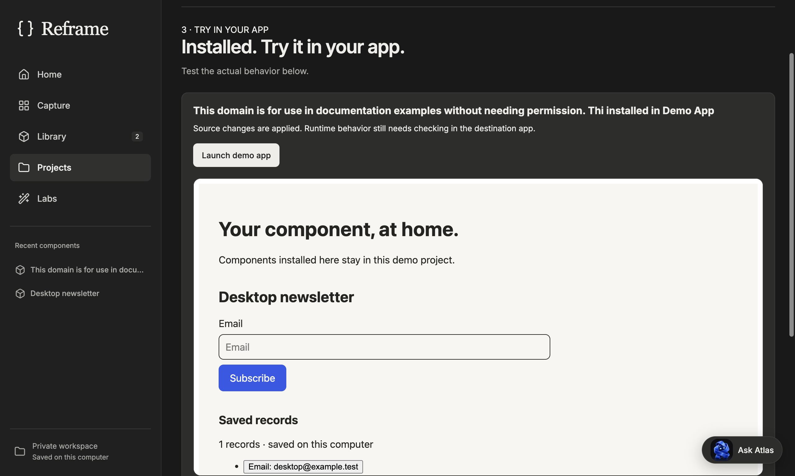

# Reframe macOS release assessment — 23 October 2026

Reframe now has a clearer core: **capture → Library → working preview → export/install**. My provisional engineering assessment is **8.9/10**, up from the earlier 8.8/10 assessment. These scores are judgments informed by the checks below, not measured adoption or a claim that every website can be reconstructed. A 9/10 product claim still needs newcomer testing and installation on another Mac.

## Startup speed refinement — current delivery

The current delivery uses a sealed backend archive instead of 17,645 loose backend entries. Electron loads its small bootstrap directly; the backend archive is extracted once into the existing atomic, versioned private cache. DMG launches also prepare the Node/Chromium/OCR runtimes there. Installed copies extract the backend but use their bundled native runtimes directly. A failed or interrupted extraction does not replace the previous complete cache or touch the Library. Node's compile cache persists across backend restarts. The desktop Library importer now resolves its implementation from the prepared backend location.

This follows Electron's [measure-first performance guidance](https://www.electronjs.org/docs/latest/tutorial/performance). No capture capability was removed, no startup timeout was increased, and Home's visual design is unchanged.

All measurements below are observations on this same 8 GB Apple Silicon Mac, with the development server still running. Fresh profile means no Reframe engine/compile cache; **it does not mean a rebooted Mac or an empty OS filesystem cache**. Background system load and debugger attachment still vary. Broader test/build jobs were finished before these runtime timings.

| Measurement | Previous delivery | Current delivery |
| --- | --- | --- |
| Normal Launch Services DMG launch, fresh profile, no debugger | 32.7 s | **23.5 s** |
| Normal DMG repeat launch | 9.3 s | **6.4 s and 4.2 s** |
| Automated fresh-profile DMG Home, including attachment | 79.6 s in final earlier run (50.4 s in another) | **24.0 s and 18.3 s** |
| Automated DMG restart Home | 18.0 s in final earlier run (8.8 s in another) | **5.2 s and 4.4 s** |
| Complete DMG flow, including forced recovery | 280.8 s in final earlier run (121.8 s in another) | **75.0 s and 68.6 s** |
| Copied-off-DMG app, first Home / restart | 11.8 s / 4.8 s | **16.6 s / 4.6 s** |
| Copied app, complete flow | 59.4 s | **56.9 s** |
| DMG size | 510,275,333 bytes | **407,465,476 bytes (20.1% smaller)** |

The normal first DMG launch is about 28% faster than the earlier normal-launch measurement. The copied app's first-use launch is slower because it now unpacks the backend; repeat startup remains quick. This tradeoff is explicit, rather than claiming every startup got faster. Fresh DMG preparation took 6.5–8.2 seconds in the two automated runs, versus 20.5 seconds in the prior final run. Native extraction in a separate probe took 2.8 seconds versus 6.7 seconds for the old dependency-tree copy; actual startup includes runtime copies and other work.

Verified on the actual read-only DMG and on a separate writable copy:

- HTML capture → declared form behavior → isolated working preview with required-field validation → Library → reviewed installation → launched demo → real persisted form submission.
- Public-site capture using bundled Chromium → second saved component → installation beside the working form.
- Normal restart preserves both components and demo records; preview-only records stay isolated.
- Forced backend exit presents recovery; retry restores the Library and working demo.
- The final DMG rerun also imports an existing Library through the actual desktop IPC bridge, with only the folder picker stubbed to a disposable fixture. The saved components coexist after import.
- Sandboxing, context isolation and disabled renderer Node access remain verified. Web content cannot invoke recovery. All 16 tracked owned processes close after the first flow; the backend/demo endpoints close on exit.
- Runtime PATH contains only macOS system directories. Bundled OCR and Chromium work without global Node, Chrome or Swift. The compile-cache files are written and reused.
- Strict local ad-hoc signature verification passes on the mounted delivery and the copied app. No `.env`, `.reframe` or `.git` entries occur inside the backend archive. The real development Library fingerprint remains unchanged.

The broader suite initially passed 161/162 tests. The one failure was a scheduling-dependent assertion: either of two concurrent package-version reads may finish first. The corrected test requires exactly one real analysis, one reused result and identical evidence, without assuming which caller wins; mutable-result isolation remains tested. No production analysis behavior changed for that test correction. The final clean `npm run verify` passed **all 162 tests**, formatting, ESLint, client/server type checks and all three production builds; [complete log](evidence/startup-speed-2026-10-23/verification.log).

**Assessment remains 8.9/10 overall.** Startup is materially better, but 23.5 seconds for a first normal DMG launch is still too long for an excellent first impression. Do not translate a faster engineering test into a 10/10 product claim. Remaining gates are shorter first-use preparation, independent newcomer testing, installation on a second Mac, and Developer ID/notarization validation. No paid OpenAI call, physical camera test or native Android/iOS runtime test was part of this startup work.

Evidence: [normal launches](evidence/startup-speed-2026-10-23/finder-launches.json), [first DMG flow](evidence/startup-speed-2026-10-23/dmg-flow.json), [final DMG flow with import](evidence/startup-speed-2026-10-23/final-dmg-flow.json), [copied app flow](evidence/startup-speed-2026-10-23/installed-flow.json), [copy/extraction probe](evidence/startup-speed-2026-10-23/preparation-probe.json), [artifact identity](evidence/startup-speed-2026-10-23/artifact.json).

## Earlier direct DMG startup follow-up (before archive optimization)

The mounted-image startup blocker is resolved in the tested paths. Reframe now shows a local startup screen before waiting for its backend. If the backend exits, times out or cannot spawn, recovery offers **Try again** and a diagnostic log. Retry stops the previous owned process first. Recovery IPC is restricted to the app's own top-level recovery document; web content cannot trigger it. Even an unwritable log directory cannot suppress the recovery screen.

Read-only launches prepare the shipped backend and Node/Chromium/OCR files in a private, versioned execution cache under Electron user data. The version key derives from the bundle resource seal. Preparation commits only after required files exist, cleans interrupted staging, reuses complete versions and removes obsolete completed caches after the replacement is ready. The Library remains separate. At that stage, installed copies ran directly from their application bundle; the newer archive package described above prepares its backend cache for both launch locations. Cache preparation uses roughly **760 MB** of additional local storage and needs no downloads or credentials.

The DMG now uses ULFO compression. Compression alone improved one observed run but did not remove the waiting; it is not presented as the sole fix. A native copy-tool comparison took 13.9 seconds versus roughly 14–15 seconds for current preparation, so no additional copy implementation was added.

Fresh profiles on this 8 GB Mac, with the development server still running:

| Probe | Observed result |
| --- | --- |
| Earlier UDZO DMG, original startup | Full flow 180.5 s; capture browser 33.6 s |
| ULFO plus recovery, before engine cache | Full flow including recovery 107.8 s; browser 15.8 s |
| Private engine cache, first full DMG run | Full flow including recovery 121.8 s; browser 9.0 s; first Home 50.4 s under Electron automation; restart Home 8.8 s |
| Delivery DMG, repeated fresh-profile run after final recovery copy | Full flow **280.8 s**, first Home **79.6 s**, restart **18.0 s**, browser **12.5 s**; all behavior and recovery assertions still passed |
| Final app copied off the DMG to a normal writable installation folder | Full flow including recovery **59.4 s**; first Home **11.8 s**, restart **4.8 s**; no engine cache needed |
| Finder-style launch via Launch Services, no debugger | Fresh-profile Home **32.7 s**, repeat launch **9.3 s**; native UI visibly showed preparation and then Home |

These are sequential observations, not a controlled compression benchmark. OS file caching, memory pressure and automation attachment affect the measurements. **The first launch is still too slow and variable for a 10/10 claim.** The final delivery run was substantially slower despite passing; it is retained rather than selecting only favorable timings. Preparing a local engine trades one-time setup and disk space for avoiding runtime execution from the compressed image.

The final read-only DMG test captured an HTML form, authored real behavior, tested validation and isolated preview, saved to Library, reviewed/installed it, submitted a real demo record, captured example.com through bundled Chromium and installed a second component beside the form. Restart and a deliberately stopped backend both retained the Library and real record; preview-only data stayed isolated. Sixteen observed owned processes closed on the normal shutdown. The renderer stayed sandboxed and context-isolated with Node disabled; no page errors occurred. A normal launch was also observed through native accessibility UI. This is an agent-operated fresh-profile test, not independent newcomer research.

The full check passed **162 tests**, formatting, lint, client/server type checks and all three production builds. New regressions cover timeout/spawn/storage failures, recovery origin/frame checks, complete cache reuse, version changes and interrupted preparation. [Verification log](evidence/startup-2026-10-23/verification.log).

Evidence: [final delivery workflow](evidence/startup-2026-10-23/delivery-flow.json), [artifact seal and source checks](evidence/startup-2026-10-23/artifact.json), [installed workflow](evidence/startup-2026-10-23/installed-flow.json), [DMG workflow](evidence/startup-2026-10-23/dmg-flow.json), [Finder launches](evidence/startup-2026-10-23/finder-launches.json), [recovery screen](evidence/startup-2026-10-23/recovery.png), [two installed components](evidence/startup-2026-10-23/installed-components.png). Both the mounted and copied app pass strict ad-hoc signature verification. Developer ID signing, notarization, a second Mac and independent newcomer usability remain unverified.

## Earlier source-analysis and packaged-runtime follow-up

Repeated source reviews now reuse bounded, process-local REA evidence keyed by exact filenames, contents and the installed REA version. Concurrent identical requests share one analysis. The cache holds at most eight results / 16 MiB; edits and version changes require new evidence. Validation, policy checks and canonical source compilation still run. No source is sent to an AI provider, and failed analysis is not cached.

A controlled 74,950-byte feature review took **5,654 / 3,947 / 3,490 ms** before, versus **5,112 / 56 / 38 ms** after. The repeated-review mean is approximately **98.7% lower**. This does not make cold analysis instantaneous: the first review remains roughly five seconds when the machine is not busy. Packaging and the full test suite running simultaneously increased cold checks substantially; these are local CPU workloads.

Two additional release defects were repaired:

- Different saved packages used the same installation name. Defaults now derive from a stable package identity, survive Library renames and differ between components. Reviewed file-conflict protection remains intact. Receipts show the component's display name.
- Local OCR tried to compile into the installed app bundle. The desktop runtime now includes a compiled macOS Vision helper targeting macOS 13, matching Electron's minimum. Desktop capture needs neither a Swift compiler nor a writable app bundle. Development compilation uses the configured workspace store. A later read-only DMG probe exposed a Neural Engine compilation stall; CPU OCR recognized the same 29 text blocks in 964 / 472 / 671 ms. Nine desktop/native regression tests passed after this final helper change.

The repeatable `scripts/verify-desktop.mjs` exercises actual Electron UI, bundled OCR and Chromium, a working form backend, a public example.com capture, two installations into the same demo, validation, persistence and restart, plus process cleanup. It accepts an app executable path, including one mounted from a read-only DMG, and uses isolated data with a system-only PATH. It makes no paid model requests.

The final DMG passes `codesign --verify --deep --strict` with a local ad-hoc resource seal. Its app was copied into an isolated installation folder outside the project and passed the full workflow in **75.6 seconds**: screenshot OCR, HTML capture → authored form behavior → isolated preview → Library → reviewed install → real submission/reload; then live example.com capture and a second installation alongside the form. Restart retained the real record and excluded preview-only data. All **16 observed owned processes** closed, both endpoints stopped, and no page errors occurred. Sandbox/context isolation remained enabled with Node disabled; only bundled runtimes and a system-only PATH were used.

In that final run, OCR took **1.1 s**, first feature review **5.7 s**, reused installation review **88 ms**, bundled Chromium startup **5.5 s**, and the first review of the website package **11.0 s**. These are workflow observations, separate from the controlled repeated-review benchmark.

Packaging now seals a temporary copy outside the project folder, removes only FinderInfo/resource-fork metadata, preserves executable entitlements/flags, and verifies the seal before creating the DMG. Finder metadata was observed reappearing on the standalone `.app` inside the Documents project folder, so the verified DMG is the delivery artifact. An ad-hoc seal is **not** Developer ID signing or notarization.

**Historical counterexample, before the startup follow-up above:** earlier compressed DMG probes exceeded browser deadlines, even without the development server. An uncompressed image completed the full flow but took **244.3 s**. The corrected sealed DMG passed signature verification but its direct-launch automation still exceeded the 60-second Electron connection deadline. At that stage the normal copied-app flow passed, while direct mounted-image launch remained unreliable. The follow-up above records the current results and remaining first-launch cost. [Uncompressed comparison](evidence/analysis-2026-10-23/uncompressed-dmg-flow.json), [sealed-image timeout](evidence/analysis-2026-10-23/sealed-dmg-launch-timeout.log), [strict signature check](evidence/analysis-2026-10-23/signature-check.log).

[Packaged workflow evidence](evidence/analysis-2026-10-23/packaged-app-flow.json), [installed demo screenshot](evidence/analysis-2026-10-23/packaged-two-components.png), [cold-DMG failure](evidence/analysis-2026-10-23/dmg-cold-failure.log), [artifact hash and bundle scan](evidence/analysis-2026-10-23/artifact.json).

## Same nine-area scorecard

| Area | Previous | Current | Evidence and remaining limit |
| --- | ---: | ---: | --- |
| Capture → Library loop | 8.5 | 9.0 | Real extension receipt, isolated Chromium capture, durable per-item saves, reopen, preview and installation. Desktop Apple capture completed. Unknown behavior still needs a definition. |
| Capture fidelity | 8 | 8.2 | Desktop Apple button scored 94%; controlled responsive fixture measured nine viewport/state variants. Animated content, changed trees and ambiguous identities limit general fidelity. |
| Code export | 6.5 | 8.0 | Faithful default; formatted Clean React/CSS/HTML; scoped semantic classes, safe CSS pruning, keyframes and measured responsive overrides. Tabs, disclosures, dropdowns and carousels work in compiled React and the installed website runtime. Complex custom interactions remain outside automatic reconstruction. |
| Library and organisation | 7.5 | 9.0 | Small index, immutable packages, hashed shared media/fonts, image cards, bounded detail cache, ten manifests, metadata PATCH, offline replay and conflict copies. Search stays visible; filters, sorting and secondary card actions are disclosed on demand. Active filters and a single clear action remain visible. |
| Security and privacy | 8.5 | 8.5 | Local origins and pinned public networking retained; stale pairing cannot revive credentials. Desktop renderer is sandboxed, context-isolated and has no Node access. Bundles exclude credentials/captures. This is local software, not public multiuser hosting or an independent security certification. |
| Product focus and UX | 5 | 8.9 | Five destinations; protected Home appearance preserved; Library terminology; advanced features in Labs; explicit AI requests. Editor customization and exports are collapsed, the behavior builder closes after save, and one-click demo launch displays the actual installed app. Behavior choices lead to a working preview and save; installation leads with destination, affected files and data implications. Source details remain available. Unknown business rules still require user judgment. |
| Engineering quality | 6 | 8.3 | Prettier, ESLint, client types, JSDoc/checkJs on ten critical server entry modules and their imports; Library/capture state split; lazy Browser/editor/Originals chunks. This is not strict typing of every legacy Labs module. |
| Performance at scale | 5 | 9.0 | 150/500/1,000 realistic synthetic packages benchmarked. No card iframes or full-package uploads for metadata edits. Warm incremental Library memory improved 74.8–79.4% across two runs. Repeated source reviews now reuse exact evidence; first-time analysis and cold-start browser overhead remain significant. |
| Distribution | 4 | 7.5 | Apple Silicon `.app` and DMG, own Node/Chromium, fresh writable demo, one-click build/launch, explicit Library import and clean shutdown tested on this Mac. Direct read-only DMG startup, versioned local engines and in-app recovery now tested. Ad-hoc signed, without Developer ID or notarization; another Mac and public distribution remain unverified. |

## Behavior and installation follow-up

The behavior builder now has two stages: **Choose behavior → Try & save**. Inputs, sign-in settings and generated source are disclosed when needed. Switching modes preserves action choices, edits invalidate the old build, and saving returns focus to the next steps. The same plain-language behavior summary appears during installation, including shared/account-scoped storage and the distinction between saving a record and actually calling an email service.

Installation shows **Choose destination → Review & install → Try in your app**. Demo placement has a default; advanced settings, alternate components and source comparisons stay available. Review lists the destination, new/modified file counts, dependencies, behavior and runtime notes. Back returns to placement, and file mutation still requires explicit approval. Demo instructions now say Launch demo app rather than giving conflicting terminal commands. The actual backend remains guarded by reviewed file hashes and undo protection.

| Before | After | Why |
| --- | --- | --- |
| Behavior settings, generated files and code acknowledgement in one long form | Choose actions, build, try real behavior, save; source details optional | Users can verify an outcome without claiming to have audited source |
| Mode changes reset authored actions | Actions survive switching modes and returning from the preview | Avoid lost decisions |
| Installation mixes project selection, Library, fit scores and full source review | One decision at a time, concise review with explicit file-write approval | Make the next action apparent |
| Demo review requests terminal commands | Demo-specific launch instructions | Match the action the app actually offers |

The expanded fresh-profile regression passed the controlled HTML form through behavior selection, editing/rebuilding, isolated preview, required/invalid-input rejection, disk-confirmed save, reopen, export, back/review, installation, launch, valid submission and reload persistence. Preview and installed records remained separate. Desktop (1280×900) and narrow (390×844) layouts had no horizontal overflow. No page errors, automatic AI calls or full-workspace uploads were observed. The expanded runs took **52.0–102.3 seconds**, including repeated builds and review; this is automation timing, not human completion time. Source analysis latency remains an improvement opportunity.

The full release checks passed for this change: **154 tests**, formatting, lint, client/server type checks and all three production builds. `/tmp/reframe-behavior-verify.log` contains the current run. The live development Library remains five items at revision 14; tests used isolated temporary stores. Screenshots and fresh-profile evidence are in `/tmp/reframe-behavior-builder*.png`, `/tmp/reframe-installation-review*.png` and `/tmp/reframe-new-user-flow.json`. Previous packaged-app evidence below predates this follow-up; the installer is not rebuilt by this UI pass.

**9/10 gate:** this is stronger engineering evidence, not proof that a real newcomer succeeds unaided. Observe five newcomers, measure their task completion and recovery, then verify installation on another Mac. Signed distribution, complex capture fidelity and first-time source analysis remain concrete limits. Repeated source checks are now reused for identical, version-matched inputs.

## Earlier fresh-user and packaged-app verification

A fresh browser profile with an empty Library, no project folder and no OpenAI key completed **HTML capture → behavior definition → durable save → working preview → Library reopen → export → fit/review/install → one-click launch → save a record → reload**. The controlled component was a newsletter form. The installed record survived reload; preview-only records did not appear in the installed app. The automated sequence took **16.5 seconds** in a quiet run and **24.6 seconds** during concurrent verification; these are automation timings, not human completion times. Keyboard filtering, rename cancellation and 390px light/dark Library layouts passed. No paid AI request or whole-workspace PUT occurred.

A separate fresh-profile public-site flow picked the paragraph on **example.com**, saved it durably and installed/rendered it in the demo in **14.9 seconds**. That small, static 416×76px capture scored **100%**. This does not establish equivalent fidelity for complex sites or hidden business logic.

The final packaged Apple Silicon app repeated capture → authored backend → save → install → one-click launch, submitted a real record and retained it after quitting and restarting. It used only `/usr/bin:/bin:/usr/sbin:/sbin` in PATH. The run took **47.3 seconds** including a restart under concurrent load, had no page errors, closed all **seven observed owned processes**, and retained sandbox/context isolation with no renderer Node access. The installed demo backend stopped on application exit. A further run directly from the read-only final DMG passed the same flow and restart check in **55.6 seconds**, again closing all seven observed owned processes.

The first runs exposed and fixed a Projects null-state crash, duplicate editor preview panels, optimistic save wording, stale demo dependency links after an app move/update, and a nested website frame blocked by its ancestor policy. The demo now permits only Reframe's specific local parent origins. A permanent regression installs a website package, renders it through both frames, submits its form and verifies its receipt after reload. Another existing navigation test now waits for asynchronous menu links, rather than assuming the dialog heading means its data has loaded.

**UI QA:** page identity, meaningful rendering, framework-overlay absence, runtime console health and real action/data/reload checks passed at 1280×900 and 390×844. Library stress coverage also checks 320, 825 and 1440px in light/dark modes. The Browser plugin was not available; the repository's installed Playwright workflow provided the automated fresh-profile and packaged-app checks, with an additional in-app browser visual review.

[Fresh-profile timings and API requests](evidence/ux-2026-10-23/fresh-profile-flow.json), [public capture evidence](evidence/ux-2026-10-23/public-site-flow.json), [packaged runtime evidence](evidence/ux-2026-10-23/packaged-demo-flow.json), [read-only DMG evidence](evidence/ux-2026-10-23/dmg-demo-flow.json), [data integrity](evidence/ux-2026-10-23/data-integrity.json).

**Assessment boundary:** 8.7/10 is a provisional engineering judgment. A 9/10 product claim still needs observed newcomer success and installation on another Mac. One-click launching deliberately applies only to Reframe's generated demo; connected external projects retain their normal development commands. Captures cannot recover private services, and native device runtime remains pending.

## Verification result

`npm run verify` passed: **158 tests**, formatting, lint, client TypeScript, the dedicated server check and all three production builds. This includes a real Chrome-extension receipt, migration/offline/conflict recovery, REA/Ponytail checks, full-stack/auth/API/commerce tests, native source checks, responsive interaction exports and installed-demo behavior. Production `npm audit` reported **zero vulnerabilities**.

[Current verification log](evidence/analysis-2026-10-23/verification.log), [export comparisons](evidence/release-2026-10-23/export-comparisons.json), [desktop runtime proof](evidence/release-2026-10-23/dmg-runtime.json), [data preservation](evidence/release-2026-10-23/data-integrity.json). Earlier release formatting and behavior review patches remain under `docs/evidence/`; the new UX changes are in the working tree. No Git commits or pushes were created.

## Correctness and preservation

- Pair/revoke/statistics updates serialize; finishing captures update counters only for the current token. Revoked tokens stay revoked, and older work cannot replace a newly paired token. Concurrent capture counters are tested.
- Recapture preserves saved identity, existing name, tags, collections and theme while refreshing source. It also preserves an unchanged automatic name; no automatic rename is introduced.
- Each redirect resolves once against the responding URL. Relative chains and cross-origin credential removal are tested with Chromium; network validation and redirect limits remain active.
- Migration commits immutable objects before replacing the index, verifies object hashes and required fonts, migrates retained histories, and keeps the original workspace plus `workspace.v1.backup.json`. Interrupted migration/commit and unreadable data are tested without resetting the Library.
- All **8,947 pre-existing data files under `.reframe`** matched their pre-change SHA-256 hashes after migration/testing. The development Library still contains the same five user components. New manifests/objects are additional files. Desktop tests used a separate temporary store; importing copied the Library and did not edit its source.
- Offline status changes immediately when an edit queues. Individual IndexedDB operations replay in creation order, including multiple edits to the same item. Different-item edits merge; same-item conflicts remain recoverable as copies. Deletion/settings conflicts require a pending-operation backup and explicit resolution rather than silently choosing a version.

## Performance measurements

The benchmark uses 24 visible Library cards, realistic synthetic captured packages of about 67 KB each, actual font data, and hashed reference images. It compares the original `2f5bdde` Clipboard implementation with the new production Library surface on this Mac. It does not claim these figures represent every real website or the whole desktop application's memory.

| Components | Compact full Library | Summary index | Filesystem metadata p95 | Loopback PATCH p95 | Load populated Library after empty shell |
| ---: | ---: | ---: | ---: | ---: | ---: |
| 150 | 10.12 MB | 149 KB | 5.35 ms | 58.47 ms | 45 ms |
| 500 | 33.73 MB | 497 KB | 34.46 ms | 15.07 ms | 67 ms |
| 1,000 | 67.46 MB | 995 KB | 52.46 ms | 55.27 ms | 91 ms |

Final 150-item run:

- Card iframes: **24 → 0**. Metadata source bytes uploaded: **0**.
- Incremental browser process-tree RSS after loading an empty shell: **81.63 MB → 16.83 MB**, **79.4% lower**. A previous warm run measured **74.8% lower**.
- Incremental renderer JavaScript heap: **29.87 MB → 1.30 MB**, about **95.7% lower**.
- Populated Library load: **935 ms → 45 ms**, after separately loading the shell (1,292 ms baseline / 1,070 ms current).
- The initial cold-start comparison measured only **31.9% lower RSS** when browser/app startup was included. That result is retained; it must not be confused with the incremental Library target.
- Process-tree RSS includes shared-page double counting. Timings vary with CPU, disk and other apps. The 250 ms metadata-save target and 70% warm incremental Library-memory target were met in the recorded runs.

Reports: [final benchmark](evidence/library-benchmark-2026-10-23.json), [first warm run](evidence/library-warm-first-run-2026-10-23.json), [original cold start](evidence/library-cold-start-2026-10-23.json). Run `npm run benchmark` to repeat.

The main web chunk is about **386 KB before gzip**, versus the supplied 466 KB baseline. Browser, editor and Original implementations load separately. This is a useful reduction, not a claim that every section is independently chunked.

## Export, interaction and AI checks

The controlled component is captured at **390, 768 and 1280 px**, each in default, hover and keyboard-focus states. Capture verifies the same element tree and reports missing/ambiguous variants. Source breakpoints are retained only when supported by observations; extension captures retain their own viewport and do not resize the user's browser.

Both modes compile/render. The Clean fixture's nine comparison scores were **86.2–90.9%**, with no visual regression greater than three points versus Faithful. Low scores are still visible; a relative comparison does not imply exact reproduction. Tabs support keyboard navigation/selection, disclosures open, dropdowns support arrows/Escape/outside dismissal, and carousels change slides. The same capture is saved, reopened, compiled into a React demo, installed through Projects and tested inside the installed iframe/backend. Existing form, account, API and commerce tests cover validation, persistence, retries and error paths.

A real, explicit OpenAI UI action proposed the class name `info-text` for an example.com paragraph. **Validate & apply to export** compiled and visually checked the proposal and produced a 90% match. The saved component stayed unchanged. AI assistance is deliberately bounded to naming proposals here; source scripts and private backend logic are not recovered or executed. Other existing AI actions remain explicit in Labs/Projects. Ordinary capture, saving and deterministic exports make no OpenAI call.

Apple's captured button installs and renders locally at its original styling. Its destination lies outside that one captured component. Clicking it reports that missing route locally rather than redirecting or pretending to implement Apple's service. Reconstructing that workflow requires capturing its route or authoring a behavior contract. This boundary is intentional and should stay visible to users.

## Desktop proof and delivery

- Apple Silicon package: `out/Reframe-darwin-arm64/Reframe.app`.
- Installer: `out/make/Reframe-arm64-local-unsigned.dmg` (approximately 521 MiB).
- The renderer enables sandbox and context isolation and disables Node integration; the narrow preload exposes only the explicit import action. Camera/microphone requests require a local permission prompt. Navigation/window creation are restricted. This follows the relevant [Electron security guidance](https://www.electronjs.org/docs/latest/tutorial/security), without claiming that a checklist replaces an independent review.
- Backend and capture browser execute from **inside the `.app`** with a PATH containing only macOS system folders. No global Node or Chrome was used. Browser startup is lazy. The backend remembers its loopback port for stable extension connections, waits for readiness, and falls back when another process owns that port.
- Apple loaded, was picked, saved, reopened and previewed using the bundled runtime. After restart, Wikipedia loaded and its title was captured and saved; deduplication retained its existing copied identity. The explicit import dialog copied the five development components into the isolated six-item desktop test Library.
- The clean writable React demo accepted the reviewed Apple installation. Its actual frontend and backend were launched with the bundled Node and rendered in a browser. A missing JSX configuration found in this test was repaired in the starter; compile/render and source-preservation coverage was added.
- Restarting the final app retained the six-item test Library and reused port 5176. A fresh-profile and a normal-profile automated launch directly from the read-only DMG verified `nodeIntegration: false`, `sandbox: true`, `contextIsolation: true` and `typeof process === "undefined"` in the renderer. With the build staging folder renamed out of reach, bundled Chromium captured example.com and the save persisted after quitting. The mounted-app scan found **zero external links**, and all mounted app/browser processes closed.
- Quitting the desktop app closed **all 15 observed owned processes**, including backend and bundled Chromium. The separately launched destination test server was then stopped too.
- Runtime data belongs in `~/Library/Application Support/reframe-workbench/workspace/`, separate from the `.app` and source checkout. The native starter projects remain in the source checkout; the desktop package offers the clean React starter and connection to existing native project folders.
- No `.env`, project Library, user captures or existing demo records were found in the packaged app. Relative Chromium framework symlinks are preserved, so the package does not depend on the developer's Playwright cache.

Signing/notarization is configured through build-environment credentials and remains **pending**. The local artifact is explicitly labelled unsigned. Verified public distribution needs Apple's credentials and the [Forge signing/notarization checks](https://www.electronforge.io/guides/code-signing/code-signing-macos). Newcomer testing, another Mac, physical camera capture and Android/iOS runtime testing remain separate gates.

## Next polish, ordered by observed impact

1. **Observe five newcomers** completing the now-tested flow. Measure completion, time, errors and whether visual references, working previews and installed behavior are understood without help. Automation cannot establish this.
2. **Sign/notarize and install on a second clean Mac.** Verify Gatekeeper, import, capture, restart, update/recovery and disk space. The bundled runtime is still large and the installer is unsigned.
3. **Reduce cold desktop startup, especially when launching directly from a compressed DMG.** Install into Applications for normal use; quantify first-launch time on a clean 8 GB Mac before treating this as polished.
4. **Simplify behavior authoring and integration review from observed failures.** The Library/editor defaults are quieter; defining unfamiliar business rules and reviewing source changes remain the most demanding parts. Preserve explicit review and avoid invented success handlers.
5. **Expand fidelity evidence.** Test complex nested components, variable fonts, repeated instances and longer interaction sequences. Keep the faithful alternative and flag ambiguity.
6. **Extend server typing through legacy Labs modules.** The release-critical path, including the new launcher, is checked. Legacy experimental modules are not all strictly typed.

Deferred as agreed: Tailwind output, expanded brand kits, recapture/diff UI, collection/npm/Storybook packages, Figma export, licence swapping, Chrome Web Store publication and Windows/Linux packaging. Existing capabilities have not been removed to imply these are completed.

## Screenshots

- [Preserved Home](evidence/release-2026-10-23/home-desktop.png)
- [Image-based Library](evidence/release-2026-10-23/library-desktop.png)
- [390 px Library](evidence/release-2026-10-23/library-mobile.png)
- [Validated OpenAI Clean export](evidence/release-2026-10-23/ai-clean-export.png)
- [Desktop Apple Library](evidence/release-2026-10-23/desktop-apple-library.png)
- [Packaged working preview](evidence/release-2026-10-23/desktop-working-preview.png)
- [Installed Apple component](evidence/release-2026-10-23/desktop-installed-apple.png)
- [Wikipedia capture](evidence/release-2026-10-23/desktop-wikipedia-capture.png)
- [Restart persistence](evidence/release-2026-10-23/desktop-restart.png)
- [Capture directly from the portable DMG](evidence/release-2026-10-23/dmg-portable-capture.png)

## Updated UI evidence

- [Simplified editor](evidence/ux-2026-10-23/editor.png)
- [Library desktop](evidence/ux-2026-10-23/library-desktop.png)
- [Library at 390px, dark](evidence/ux-2026-10-23/library-mobile.png) and [light](evidence/ux-2026-10-23/library-mobile-light.png)
- [One-click launch receipt](evidence/ux-2026-10-23/install-receipt.png)
- [Installed backend records](evidence/ux-2026-10-23/working-demo.png)
- [Public website installed](evidence/ux-2026-10-23/public-install.png)
- [Packaged desktop flow](evidence/ux-2026-10-23/packaged-demo.png)
