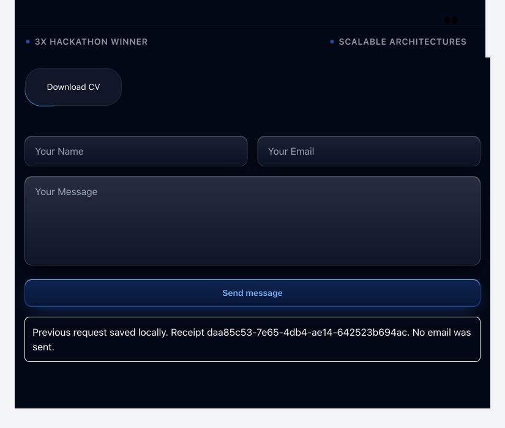

# Robin Francis capture and integration validation

Date: 22 October 2026. This validates a local Reframe → clipboard → Haven workflow, not public hosting or universal website equivalence.

## Result and scope

Reframe's own isolated browser captured these eight public pages from https://robinfrancis.in/: Home, Projects, Blog, Achievements, Gallery, My Events, Press Kit and Contact Card. The saved website ID is `5e4846d0-26d1-469b-ad61-f99e4842aec1`. Navigation among these pages and Home's section links stays inside the installed replica.

The complete website, standalone contact form, website-section CV and browser-picked CV are saved in the clipboard. All 19 earlier components remain; the exported clipboard contains 23 valid components. Three packages were installed through Projects' reviewed frontend/backend installation flow:

| Installed component | Feature ID | Source-based fit estimate |
| --- | --- | --- |
| ReframeRobinWebsite | rf_606deec03741 | 89/100 |
| ReframeRobinCV | rf_acab9ab45202 | 92/100 |
| ReframeRobinContact | rf_a9434fbcd973 | 89/100 |

These scores describe supported source/runtime integration. They do not certify visual equivalence, adoption, performance or production hosting. Reference styling is isolated and does not inherit Haven's palette; the theme score explicitly explains that tradeoff.

Run Reframe with `npm run dev` at http://localhost:5173/. Run Haven with `npm --prefix examples/integrated-app run reframe:start` at http://localhost:5175/ after building it. The installed source lives under `examples/integrated-app/reframe/features/`; imports were inserted in `examples/integrated-app/src/App.tsx`.

## Bugs fixed

- Picked controls previously lost all CSS/SVG, then passed through generic themed HTML. Browser picking now selects the enclosing interactive control and retains applicable source CSS, inline SVG, safe inline styles, inherited properties and computed fallbacks.
- Leaf captures filter unrelated CSS. Selector lists are matched intact, preserving escaped commas and `:is(...)` selectors; computed background fallbacks retain the CV's radial-gradient glow. Source responsive rules and supported CSS animation remain. Original scripts and sensitive field values are removed.
- The CV is a real local PDF download, rather than a generic action callback or a redirect to the original site.
- Website forms/buttons were previously disabled. Reframe now supplies an independent runtime for local routes, search, theme changes, supported carousel/disclosure/image/card controls, event filtering and validated local form storage.
- Captured theme variables could freeze the theme toggle; the authored runtime now updates the rendered palette.
- Desktop-only source navigation disappeared on phones. The replica has an accessible mobile menu for every captured route. Whole-site frames use a viewport-bounded height so controls are reachable inside other apps.
- Clipboard persistence avoids duplicating website data in its generated schema file. Installation always revalidates metadata and regenerates executable files; imported executable strings are not trusted.
- Webview exports now use short-lived, bounded attachment URLs. Website ZIP export regenerates/reviews the current runtime, including its standalone Node launcher.

## Live checks in Haven

- Clicked every primary/footer route on desktop and all eight routes through the phone menu at a 390px outer viewport / 358px component width. All remained on localhost; no horizontal overflow was observed.
- Search for `FoodLoop` returned the captured Home and Projects pages.
- Event search for `Codex` returned four cards; the Hackathons filter narrowed it to one.
- Project-card and gallery-image dialogs opened and closed locally.
- Theme toggle changed the rendered background from `rgb(2, 8, 23)` to `rgb(255, 255, 255)` and back.
- Picked Download CV in Reframe's browser, adapted it in Studio, saved it, reviewed the integration and installed it in Haven. Its visible control measures 160 × 64px with 28px corners. The actual downloaded PDF is 80,412 bytes and its SHA-256 matches the bundled PDF.
- Submitted both the standalone contact form and the form inside the complete website. Each produced an independent durable receipt; both survived reloading Haven. No email or live-site submission occurred.
- Exported the clipboard through the UI. All 23 items pass `isItem`; neither the new form test records nor an OpenAI server secret appear in the backup.
- All 13 pre-existing runtime data/security files retain their original SHA-256 hashes. The protected `src/Home.tsx` and `src/home.css` hashes also match their initial values.

## Automated coverage

The suite covers HTML/SVG/style sanitization; preserved CV geometry and downloads; source-CSS pruning; safe metadata recompilation; local routes; required/email validation; duplicate/concurrent submission handling; persistent receipts; foreign-origin rejection; temporary exports; nested working previews; mobile navigation; safe source-file size limits; and standalone website execution from a folder containing spaces. The portable launcher was run independently and its form/PDF endpoints were exercised.

Final command: `npm run verify` passed **120 tests**, TypeScript and all three production builds. Log: `/tmp/reframe-robin-completion.log`. Browser checks were performed against the running local Reframe and rebuilt Haven applications; both final browser consoles contain no errors.

Deliverables: [portable working website](evidence/robin-working-website.zip), [installed demo](http://localhost:5175/) and [final clipboard backup](</Users/robinfrancis/Downloads/reframe-clipboard (2).json>). The final browser-picked item is named **Download CV · faithful capture** and retains the original genuine reference screenshot.

## Engines actually exercised

- REA 6.7.0 analyzed canonical generated frontend/backend source and returned evidence IDs during capture and integration reviews.
- Ponytail 5.3.2 policy checks parsed the real generated sources and found zero added dependencies. This is a bounded structural check, not a mathematical proof of minimum code size.
- Reframe Copy Polish reviewed the source text/comments. It is our independent replacement for the inaccessible Turnitout core; this does not claim execution of the original proprietary engine.

## Remaining boundaries

This is an eight-page capture, with 114 discovered URLs outside that set. Deeper blog/event pages are not mirrored. Uncaptured routes and unsupported custom actions explain what needs a further capture or explicit behavior contract.

Images remain online source references. Public PDFs are bundled; custom fonts are bundled when available. Video, canvas, original JavaScript, private APIs, original AI assistants, account rules and payment systems are not recovered. Form delivery is local storage with receipts, not email. The backend is a bounded local workspace implementation, not a public multiuser service. Native-device runtimes were not exercised in this web task.
